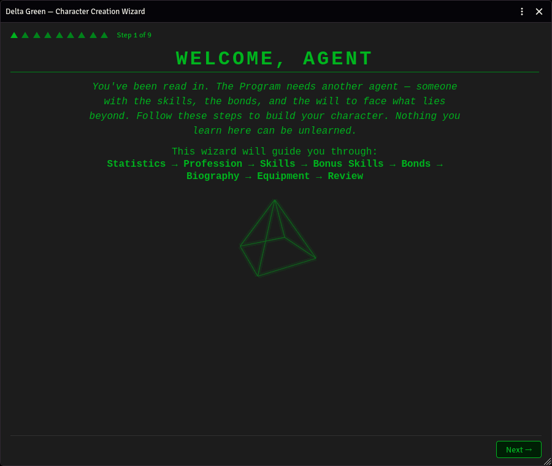
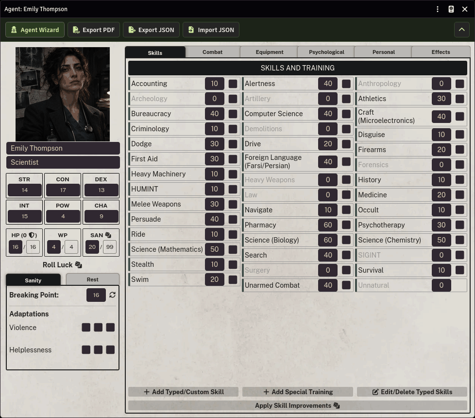

# Delta Green Character Creation Wizard — Foundry VTT Module

A step-by-step character creation wizard for the **Delta Green** RPG system in Foundry VTT. A port of the [DELTA-GREEN-STATS](https://github.com/PigeonFX/DELTA-GREEN-STATS) web app — same profession data, same skill rules, same optional pick logic — packaged as a Foundry module.

---

### The Wizard



Walk through Statistics, Profession, Skills, Bonus Picks, Bonds, Biography, Equipment, and Review — all in one guided flow inside Foundry.

### Applied to the Sheet



Once you click **Apply to Sheet**, every stat, skill, bond, and biography field is written directly to the Delta Green actor — no copy-pasting required.

---

## Requirements

One module package supports **Foundry VTT v13 and v14**. Install the [Delta Green system](https://github.com/deltagreen-foundryvtt/delta-green-foundry-vtt-system) version that matches your Foundry version.

| Foundry VTT | Tested Foundry build | Tested Delta Green system |
| --- | --- | --- |
| v13 | 13.351 | 1.6.5 |
| v14 | 14.370 | 2.0.1 |

See the [live test results](REVIEW-IMPROVEMENTS.md) for the workflows tested on each combination.

## Installation

1. Copy the `delta-green-agent-wizard` folder into your Foundry `Data/modules/` directory.
2. Launch Foundry and enable the module in your world's Module Management screen.

## Usage

Click **Agent Wizard** in the toolbar at the top of an **Agent** sheet. If the toolbar is collapsed, click **Agent tools** to expand it.

1. **Statistics** — Set STR / CON / DEX / INT / POW / CHA via point-buy (72 pts), random dice (4d6 drop lowest), or manual entry. The 72-point budget is enforced in point-buy mode; rolled and manually entered totals are kept as set.
2. **Profession** — Choose from all official Delta Green professions. Full description and bond limit shown.
3. **Skills** — Optional profession skills appear at the top as checkboxes with a pick counter enforcing the correct limit (1–5 depending on profession). Required specialty skills (Foreign Language, Science, Craft, etc.) have inline text inputs. The full required skills table is shown below for reference.
4. **Bonus Skills** — 8 bonus skill picks from your Agent's background. Choose from preset background packages or pick individually. Specialty skills support free-text subspecialties.
5. **Bonds** — Add bonds up to the profession's allowed maximum. Suggest random bonds from themed pools (Friends & Family, Delta Green, Underworld, LGBTQ+, PISCES).
6. **Biography** — Name, profession/job title, employer, nationality, sex, age, and education. Add up to 5 motivations — deeply held beliefs that can restore Willpower once per session. Hit **🎲 Random Bio** to auto-generate details matched to the chosen profession.
7. **Equipment** — Choose a preset loadout or browse the full catalog. Filter by category or search by name.
8. **Review** — Check everything, then click **Apply to Sheet** to write all data to the Foundry actor.

### Agent Sheet Toolbar

Every Agent sheet gets a small toolbar above the sheet content:

- **Agent Wizard** — launch/resume the wizard.
- **Export PDF** — fill the official DD Form 315 from the *saved* actor data (fill in the wizard, Apply to Sheet, then export). Physical description and wounds are taken from the agent's sheet; personal details has no source field in the Delta Green schema and stays blank.
- **Export JSON** — download a backup of the agent's system data, items, and active effects.
- **Import JSON** — restore such a backup. You are shown a confirmation naming the actor before anything changes. In the backup format, a present `items`/`effects` array is authoritative: restoring a backup with `items: []` replaces the inventory with an empty one. A backup missing those arrays leaves those parts untouched. If a write fails part-way, the restore rolls the agent back to its pre-restore state.

### PDF Export

The **Export PDF** button on the agent sheet toolbar exports a filled DD Form 315 — the official Delta Green character sheet. Weapons, skills, specialty instances, bonds, distinguishing features, current/maximum HP, WP and SAN, wounds, and physical description are all mapped to the correct PDF fields.

### Persistence

Wizard progress is saved on the Agent after moving between steps. After **Apply to Sheet**, reopening the wizard opens Review with your saved choices. Select a section to edit it, then use **Apply Changes** to apply the difference from your previous build. Unchanged selections keep their existing sheet values and items.

Earlier versions discarded completed choices. For an Agent with sheet data and no saved build, the wizard explains the situation and asks before applying a new build. The Agent sheet is available for direct edits in that case.

## File Layout

```
delta-green-agent-wizard/
  module.json
  scripts/
    main.js          ← Foundry hooks, sheet bar button injection, actor PDF export, JSON backup/restore
    wizard.js        ← ApplicationV2 step-by-step wizard class
    constants.js     ← Shared profession, skill, bond, and equipment constants
    pdf-export.js    ← DD Form 315 PDF field mapper (pdf-lib)
    professions.js   ← All official profession data (ported from DELTA-GREEN-STATS)
    bonds.js         ← Bond suggestion pool (ported from DELTA-GREEN-STATS)
    bio-data.js      ← Random biography generator
    equipment.js     ← Full equipment catalog with weapon stats
    vendor/
      pdf-lib.min.js ← pdf-lib 1.17.1 (MIT), vendored for offline PDF export
  templates/
    wizard.hbs       ← Handlebars template for all wizard steps
  styles/
    module.css       ← Dark-themed UI matching the DG system aesthetic
  assets/
    Delta-Green-RPG-Character-Sheet.pdf  ← Fillable DD Form 315 template
```

## Relationship to DELTA-GREEN-STATS

This module is a direct port of the [DELTA-GREEN-STATS](https://github.com/PigeonFX/DELTA-GREEN-STATS) web app to Foundry VTT. The profession data (`professions.js`), bond pool (`bonds.js`), skill rules, optional pick limits, and PDF field mappings are kept identical to the source. Only the presentation layer differs — Handlebars templates and Foundry ApplicationV2 instead of plain HTML/JS DOM manipulation.

**Documented deviations** (as required by `AGENTS.md`):

- Four professions (`anthropologist`, `foreign_service`, `intelligence_analyst`, `intelligence_case_officer`) drop the source app's *preset* subspecialty labels (e.g. "Foreign Language (Spanish)" → "Foreign Language"). The wizard collects subspecialty labels interactively, so the preset values would be pre-filled answers the player never chose.
- The PDF export ships **vendored pdf-lib** (`scripts/vendor/pdf-lib.min.js`) with the source app's CDN URL as fallback, so exports work on offline/LAN-only servers.
- The wizard's in-wizard PDF export affordance (present in the web app) is not offered in Foundry; export happens from the agent sheet toolbar against saved data.

## License

Licensed under the [PolyForm Noncommercial License 1.0.0](LICENSE) — matching the upstream DELTA-GREEN-STATS project from which the data and PDF mapping are ported. (The README previously stated MIT; that was incorrect for derived data and is corrected here pending owner confirmation — see `REVIEW-IMPROVEMENTS.md` Q5.)
